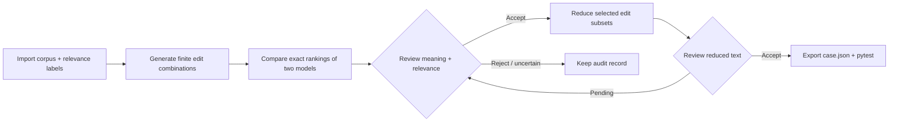
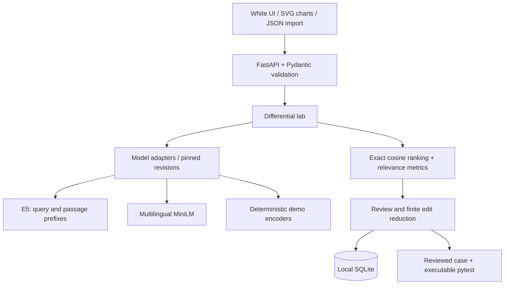

# Embedding Microscope

**English** · [简体中文](README.zh-CN.md)

[**Open the full online lab →**](https://kitho-lee.github.io/embedding-microscope/)

### Find the questions that make your retriever fetch the wrong passage.

**Embedding Microscope is a debugging tool for the retrieval step in AI question-answering and RAG systems.**

Give it a small set of documents, questions, and IDs of the documents that should answer each question. It runs two embedding models on the same data, shows where their results disagree, and checks whether rewording a question makes a correct result turn into a wrong one.

For a reviewed failure, it removes unnecessary edits and exports a regression test. You can keep that test when changing models or retrieval settings, so a known error does not quietly return.

### What goes in, what comes out?

| You provide | The tool does | You get |
| --- | --- | --- |
| Documents, questions and correct-document IDs | Compare the two models' retrieved rankings | Questions where one model finds the right evidence and another does not |
| Candidate rewrites of a question | Search the supplied edit combinations | A concrete wording change that triggers a failure |
| Your review of the wording and labels | Remove unnecessary edits while preserving the failure | A smaller, understandable case and an executable regression test |

An embedding model turns text into numeric vectors to retrieve similar content. **Similar content is not always the right answer.** This tool checks retrieval against your relevance labels; it does not judge an entire chatbot or generate answers for you.

Use it when selecting an embedding model, investigating a RAG retrieval bug, or testing a model migration. Open the [online lab](https://kitho-lee.github.io/embedding-microscope/) without installing Python, or use the Python edition below.

## One experiment, one visible failure

In the verified three-document example, the two questions below ask for the same lender:

```text
Original    李明向谁借钱？
Paraphrase  谁把钱借给了李明？
Relevant    李明向王芳借了100元。
Distractor  张伟向李明借了100元。
```

| Pinned model | Original relevant rank | Paraphrase relevant rank |
| --- | ---: | ---: |
| multilingual-e5-small | 1 | 1 |
| paraphrase-multilingual-MiniLM-L12-v2 | 1 | 2 |

MiniLM ranks a distractor describing Zhang borrowing FROM Li above the passage describing who lent TO Li. E5 stays correct in this case. This small, reproducible observation is not a general ranking of model quality; the score gap is small.


## The workflow



- **Import:** JSON files or pasted datasets, with stable document/query IDs and binary relevance labels.
- **Discover:** original queries and edit combinations; inspect single-model failures or perturbations that introduce failures in both models.
- **Review:** accept, reject or mark uncertain, with a written reason. No LLM silently decides relevance.
- **Reduce:** preserve the same winning and failing model while removing unnecessary edits.
- **Export:** executable desired-behavior regression tests, review records, model revisions and input provenance.

The white interface uses a baseline rank matrix, per-candidate slope charts, edit diffs and reduction traces. It reports **retrieval behavior in the original vector space**, rather than treating a 2D projection as evidence.

## What is technically substantial

| Component | Implementation | Why it matters |
| --- | --- | --- |
| Model adapters | Pinned model revisions, normalized embeddings, E5 query/passage prefixes, CPU inference | Avoid comparing models with incorrect encoding conventions |
| Exact retrieval | Batched embeddings and matrix multiplication; deterministic ID tie-break | Separate model failures from approximate-index recall loss |
| Differential search | Cardinality-ordered combinations; text deduplication per query; explicit budgets | Make the searched space and missing coverage visible |
| Candidate ordering | Failure contrast plus best-relevant-rank gap | Avoid interpreting raw cosine scores as calibrated across models |
| Edit reduction | Exhaustive subsets of the selected candidate's edits, preserving winner/loser identity | Produce a checkable finite-space minimum, with a complete trace |
| Review gates | Pending/accepted/rejected/uncertain; fresh reduced texts require review | Prevent unverified semantic edits from becoming regression truth |
| Provenance | Canonical input/config SHA-256, package versions, model commit hashes, truncation flags | Record what was actually evaluated |
| Durable evidence | SQLite runs, review log, reduction trace, JSON and pytest export | Keep the evidence inspectable after browser reload |

**The reduction algorithm is exact in a small finite space, not a new adversarial-search algorithm.** At most six rules produce 63 non-empty subsets. A two-edit real example reduces to one: replacing the question mark is unnecessary; the borrowing-direction paraphrase preserves the failure. Synthetic tests also cover a three-edit case reducing to one.

For `T` evaluated queries/variants, `N` documents and embedding dimension `D`, dense scoring costs roughly `O(2 × T × N × D)`, plus model encoding. The document matrix is computed once per model per run and reused across queries. The current bounded local workflow supports 200 documents and 20 queries; it is not a million-document serving system.

## Architecture



Core source: `app/engine.py`, `app/lab.py`, `app/lab_api.py`, `app/hunt.py`. Browser visuals are native SVG and CSS; no external font, chart CDN or frontend build is required. Existing single-query experiments remain at `/experiment`.

## Run locally

Python 3.10+:

```bash
git clone https://github.com/Kitho-Lee/embedding-microscope.git
cd embedding-microscope
python -m venv .venv
source .venv/bin/activate
pip install -e '.[models,test]'
uvicorn app.main:app --host 127.0.0.1 --port 8000
```

Open http://127.0.0.1:8000. Load the real-model example, validate, search, inspect rankings and review candidates. First use downloads model weights from Hugging Face; subsequent runs use the local cache.

For the download-free demo encoders, install `pip install -e '.[test]'` and select `demo-word` and `demo-char`. They are deterministic hashed lexical baselines, **not semantic models**.

## Dataset format

See [`examples/dataset.json`](examples/dataset.json):

```json
{
  "documents": [
    {"id": "d1", "text": "Relevant passage"},
    {"id": "d2", "text": "Distractor"}
  ],
  "queries": [{
    "id": "q1", "text": "Original query", "relevant": ["d1"],
    "rules": [{"source": "Original", "replacement": "Initial"}]
  }],
  "models": ["demo-word", "demo-char"],
  "k": 1,
  "budget_per_query": 63
}
```

IDs must be unique; labels must refer to existing documents. Rule sources must occur exactly once and must not overlap. Rules propose rewrites; their semantic validity is assessed during review. File import fills the model, k and budget controls, which can subsequently override the JSON values.

Empty rules compare baseline queries. File import is capped at 5 MiB in the UI. API constraints are 200 documents, 20 queries, six rules/query and 63 variants/query.

## Validation and reproducibility

**17 implementation tests passed** in the verified environment. They cover invalid imports, unknown labels, overlapping edits, budgets, persisted reviews, export gates and exact subset reduction. Browser verification covered actual file import, dual-model search, review, 2→1 reduction, persistence across reload and ZIP export.

```bash
pytest
python scripts/verify_real_models.py
python scripts/verify_lab.py
```

Both real models were downloaded and run on CPU. Six small paired cases validate embedding dimensions (384), unit norm, finite scores, independent metric calculations and matching replay rankings/scores within `1e-6`. Machine-readable evidence is under [`verification/`](verification/). The installed package-version snapshot is [`requirements-verified.txt`](requirements-verified.txt); it is **not a portable cross-platform lockfile**.

A regression ZIP contains `case.json`, `test_regression.py` and instructions:

```bash
pytest path/to/test_regression.py
```

This test expresses desired relevance behavior and **should fail on a known model failure until retrieval is repaired**. The default project suite excludes intentional failure examples. The exported case distinguishes baseline failures from newly introduced failures.

Run and review state persists in `work/lab.sqlite`, excluded from Git. Set `EM_LAB_DB` to change its location. Export full run JSON to archive the config, rankings, provenance and audit trail. SQLite uses local single-user state; no authentication or multi-user review isolation is provided.

## Scientific boundaries

- Retrieval failure means **no labeled relevant document in Top-k**. It is not a general score of language understanding.
- Labels and semantic equivalence need review. Acceptance records a judgment; it does not mathematically prove equivalence.
- Minimum means minimum number of rules among subsets of the selected candidate's edits. It does not mean globally minimal text or character edit distance.
- Rankings and label-based metrics are compared across models; raw cosine score magnitudes are not treated as calibrated.
- Long inputs can be truncated. Candidate/export warnings identify this; investigate truncation before attributing a failure to semantics.
- Hand-authored examples validate the tool, not production performance. No representative benchmark, held-out repair study or model fine-tuning is claimed.

## Prior work and design references

These individual ideas have substantial prior work: [CheckList](https://github.com/marcotcr/checklist), [TextAttack](https://github.com/QData/TextAttack), [Embedding Comparator](https://vis.mit.edu/pubs/embedding-comparator.pdf), [WizMap](https://github.com/poloclub/wizmap), [Aquin CLI](https://www.aquin.app/docs/inspection/embedding), and [ALEE](https://github.com/Andrian0s/any-lang-embed-eval). Our focus is a small, inspectable **corpus → differential → review → reduction → regression** workflow. No first-of-its-kind claim is made.

The interface respects reduced-motion preferences and uses labels alongside color.

Model conventions: [E5 model card](https://huggingface.co/intfloat/multilingual-e5-small), [MiniLM model card](https://huggingface.co/sentence-transformers/paraphrase-multilingual-MiniLM-L12-v2), [Sentence Transformers](https://sbert.net/docs/package_reference/sentence_transformer/model.html). Historical v0.1/v0.2 details: [`docs/REFERENCE.md`](docs/REFERENCE.md).

## Next experiments

- Human-verified minimal-pair datasets for user domains.
- Held-out BM25/hybrid/reranker repair comparisons, including latency and regressions.
- Larger-corpus candidate indexing with exact retrieval as the reference.
- Corpus-level batch triage and reviewed dataset exchange.

MIT licensed. Model weights retain their own licenses.

## Languages

Choose 简体中文, 繁體中文 or English using the language selector. The choice is remembered across both labs. Interface and graph labels are translated; imported text, relevance labels and review notes retain their original language. Language changes preserve editor drafts and review notes in session storage.

UI translations live in `app/static/ui-en.json`. Run `python scripts/build_i18n.py` after changing authored Chinese UI strings. Generated English files contain no automatic translation of user datasets or notes. No screenshot images are embedded in either interface or README.

## First experiment: six steps

1. Load the download-free demo to explore the UI, or the real-model example after installing model dependencies. You can also import your own JSON.
2. Validate the import, choose two models, set Top-k and the variant budget, then run differential search. Ctrl / ⌘ + Enter also runs search.
3. Read the baseline matrix and candidate rank-change charts. Green means a relevant Top-k hit; red means none. Higher positions mean better ranks.
4. Expand rankings, inspect labels and meaning, write a rationale, then accept/reject/mark uncertain. Search, sort and filter candidates to triage a run.
5. Reduce an accepted differential candidate. Inspect the subset trace and review any new reduced text separately.
6. Export the reviewed regression ZIP, extract it, and run `pytest test_regression.py` with this project installed. Known retrieval failures should fail until repaired.

The in-page **How to use** dialog follows this same sequence. Demo encoders are lexical baselines, not semantic models.

## Troubleshooting

- **First run is slow:** real weights download from Hugging Face. Check connectivity and server logs; use demo encoders to explore without downloads.
- **No candidates:** no differential or new failure was found in the tested finite space; this does not prove general robustness.
- **Reduce/export disabled:** enter a review rationale and accept the case. Reduction requires one successful and one failing model.
- **Generated pytest fails:** expected for known failures; the test should pass only after retrieval is repaired.
- **Chinese text in English UI:** user queries, corpus text and notes retain their original language.

On Windows PowerShell, activate the virtual environment using `.venv\Scripts\Activate.ps1`.

## Full online edition

The GitHub Pages site runs real models on arbitrary imported corpora **inside the browser**, not through prerecorded results. No Python, account or API key is needed. It uses Transformers.js 3.8.1, pinned Xenova ONNX conversions and q8 WASM inference, with E5 query/passage prefixes, mean pooling and normalized vectors. First use downloads sizeable model weights from Hugging Face and the runtime from jsDelivr; the browser caches them. Performance depends on browser memory and CPU. Corpus text is not sent to a model inference server.

Simplified Chinese, Traditional Chinese and English are selectable. Search, review, reduction and run storage execute in-browser. Real-model exports contain a Node.js regression test; demo encoders export a JSON case. The Python edition retains pytest exports. Quantization and runtime differences can change near-tied rankings, so browser results are identified separately from the Python fp32 verification evidence.

Online regressions: extract the ZIP, install Node.js 18+, run `npm install @huggingface/transformers@3.8.1`, then `node test_regression.mjs`. Node CPU and browser WASM may differ on near-ties; inspect scores before claiming exact cross-runtime reproduction.

The site source is in `docs/site/`. After interface changes, run `python scripts/build_i18n.py` and `python scripts/build_site.py`; GitHub Pages publishes the `/docs` directory. Pure browser metric and edit tests run with `node --test tests/test_browser.mjs`.
