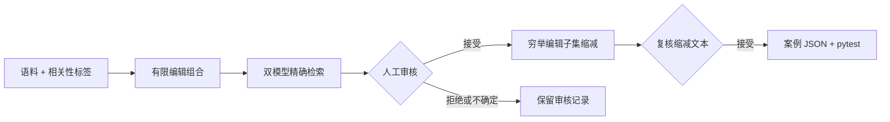
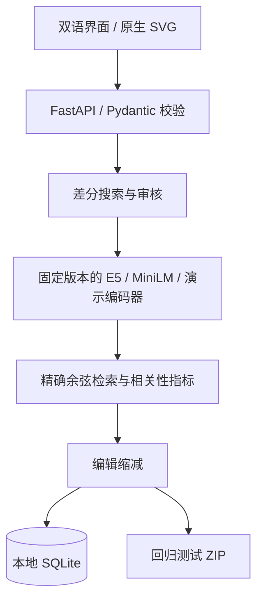

# Embedding Microscope

[English](README.md) · **简体中文**

### 让检索行为变成可以检查的证据。

导入你的语料与相关性标签，对比两个 embedding 模型，审核改写后的失败案例，缩减不必要的编辑，并导出可执行的 pytest 回归测试。界面支持中文 / English，自带原生 SVG 排名图、模型矩阵和缩减轨迹，不使用截图展示结果。

## 先看一个真实运行的例子

| 查询 | E5 相关文档排名 | MiniLM 相关文档排名 |
| --- | ---: | ---: |
| 李明向谁借钱？ | 1 | 1 |
| 谁把钱借给了李明？ | 1 | 2 |

两个问句都在询问李明的出借人。相关文档是“李明向王芳借了100元。”；MiniLM 在改写后将“张伟向李明借了100元。”排在前面，混淆了借入与借出。E5 在这个案例中仍然正确。

这只是固定模型版本下的小语料观察，不代表模型总体优劣；这里的分数差很小，排名也可能对环境或输入变化敏感。

## 安装与启动

需要 Python 3.10+。

```bash
git clone https://github.com/Kitho-Lee/embedding-microscope.git
cd embedding-microscope
python -m venv .venv
source .venv/bin/activate
pip install -e '.[models,test]'
uvicorn app.main:app --host 127.0.0.1 --port 8000
```

Windows PowerShell 激活环境：`.venv\Scripts\Activate.ps1`。

打开 http://127.0.0.1:8000。真实模型首次运行需要从 Hugging Face 下载权重，之后使用本地缓存。若暂时只体验界面，可以安装 `pip install -e '.[test]'`，使用“载入演示数据（无需下载）”。演示编码器是确定性的哈希词袋，不能用于判断真实模型质量。

## 第一次使用：六个步骤

1. **载入数据。**点击演示数据，或者载入真实模型示例；也可以从文件导入自己的 JSON。
2. **校验与搜索。**选择模型 A / B，设置 Top-k 和每查询变体预算，点击“校验导入”，通过后运行差分搜索。Ctrl / ⌘ + Enter 也能运行搜索。
3. **读结果。**概览矩阵展示原始查询；候选排名图展示改写前后。绿色表示 Top-k 至少包含一个相关文档，红色表示没有。图中越靠上排名越好。
4. **审核。**展开两个模型的排名表，核对文档标签与变体含义。填写审核依据，再选择接受、拒绝或不确定。可以搜索候选、按编辑数量排序或筛选审核状态。
5. **缩减。**接受模型分歧案例后点击缩减编辑，查看哪些编辑可以撤销。新文本仍需审核，不能因为算法保留了失败就自动认为语义等价。
6. **导出。**接受最终候选后导出 ZIP，解压并在已安装项目的环境中运行 `pytest test_regression.py`。已知失败在修复前应当报错，这是测试捕获问题的表现。

页面顶部“使用指南”也包含这些步骤。语言切换会记住选择，并保留输入草稿和审核备注；不会翻译或改写用户语料。

## 数据格式

参考 [`examples/dataset.json`](examples/dataset.json)。相关性为二元标签，`relevant` 是相关文档 ID 列表。

```json
{
  "documents": [
    {"id": "d1", "text": "相关文档"},
    {"id": "d2", "text": "干扰文档"}
  ],
  "queries": [{
    "id": "q1", "text": "寻找笔记软件", "relevant": ["d1"],
    "rules": [{"source": "寻找", "replacement": "找"}]
  }],
  "models": ["demo-word", "demo-char"],
  "k": 1,
  "budget_per_query": 63
}
```

文档和查询 ID 必须唯一，相关标签必须存在。每个替换片段须在原句中恰好出现一次，规则之间不能重叠。规则留空可只比较原始查询。导入会填充模型与参数，之后可以通过界面修改。

目前限制为 200 文档、20 查询、每查询 6 条规则、63 个变体；界面文件限制为 5 MiB。项目使用精确检索，适合小型诊断实验，不是大规模向量服务。

## 技术流程



| 实现 | 技术意义 |
| --- | --- |
| 固定模型 revision、E5 query/passage 前缀、归一化向量 | 避免编码约定错误，并记录权重版本 |
| 批量编码与精确矩阵检索、按 ID 确定性处理同分 | 将模型行为与近似索引损失区分开 |
| 每次运行复用文档向量、按编辑数量遍历、查询内文本去重 | 搜索预算和覆盖范围明确可查 |
| 优先级使用失败对比和相关文档排名差 | 不把不同模型的原始余弦分数当成统一尺度 |
| 缩减保留同一个成功模型与失败模型 | 在选定编辑子集内得到精确的最少规则数 |
| 审核门槛、SQLite 持久化、完整缩减轨迹 | 未审核案例不会被导出为回归真值 |
| 输入与参数 SHA-256、依赖版本、模型版本、截断提示 | 可以检查实际运行条件 |



对于总计 T 个查询与变体、N 个文档、D 维向量，两个模型的打分成本约为 `O(2 × T × N × D)`，另加模型编码成本。文档矩阵每模型每运行只计算一次。最多六条规则可产生 63 个非空子集；这是受控有限搜索，不是新的对抗攻击算法。

## 检查与复现

```bash
pytest
python scripts/verify_real_models.py
python scripts/verify_lab.py
```

实现测试覆盖非法导入、错误标签、重叠规则、预算、审核与导出门槛、持久化、缩减、输入指纹和双语页面。两种真实模型已下载并在 CPU 上运行；六组小实验检查 384 维向量、归一化、有限分数、指标独立复算和复跑一致性。真实双编辑案例也验证了 2→1 缩减及回归导出。

机器可读记录见 [`verification/`](verification/)。[`requirements-verified.txt`](requirements-verified.txt) 是已验证环境的版本快照，不是跨平台锁文件。

本地状态保存在 `work/lab.sqlite`，不会提交到 Git。可通过 `EM_LAB_DB` 修改路径；完整运行 JSON 用于保存配置、排名与审核记录。语言字符串在 `app/static/ui-en.json`；修改中文界面后运行 `python scripts/build_i18n.py` 更新英文版本。

## 常见问题

- **首次运行很慢？**真实模型需要下载权重；检查网络和服务端日志。体验界面可先选演示编码器。
- **没有候选？**当前规则空间里没有筛选到分歧或新增失败；这不能证明模型对其他扰动鲁棒。
- **缩减或导出按钮不可用？**先填写依据并接受候选。缩减仅支持一个模型成功、另一个模型失败的案例。
- **导出的测试失败？**这是已知检索问题的预期结果。修复检索行为后，它才应通过。
- **为什么英文界面还有中文句子？**查询、文档和备注属于实验数据，保留原文才能保证实验内容不变。

## 边界与相关工作

失败定义是 Top-k 没有已标注相关文档，不是通用语言理解评分。“最小”只指所选案例编辑子集内的最少规则数，不是全局或字符级最小。语义与标签依赖审核；接受记录判断，不构成数学证明。长文本可能被截断，需要先排查截断因素。

测试语料由人工编写，不能当作代表性生产基准。尚未实现独立测试集上的检索修复比较或模型微调。项目是单用户本地工具，没有多用户审核隔离。

参考 [CheckList](https://github.com/marcotcr/checklist)、[TextAttack](https://github.com/QData/TextAttack)、[WizMap](https://github.com/poloclub/wizmap)、[Aquin CLI](https://www.aquin.app/docs/inspection/embedding) 与 [ALEE](https://github.com/Andrian0s/any-lang-embed-eval)。特色是将语料、差分、审核、缩减和回归连接成可检查的工作流，不宣称首创。

MIT License。模型权重遵循各自许可证。视觉方向参考 FWA 作品，但本项目未获得 FWA 奖项或背书。
