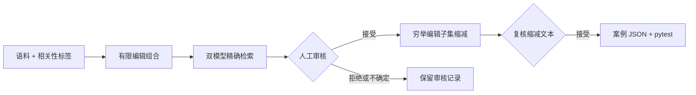
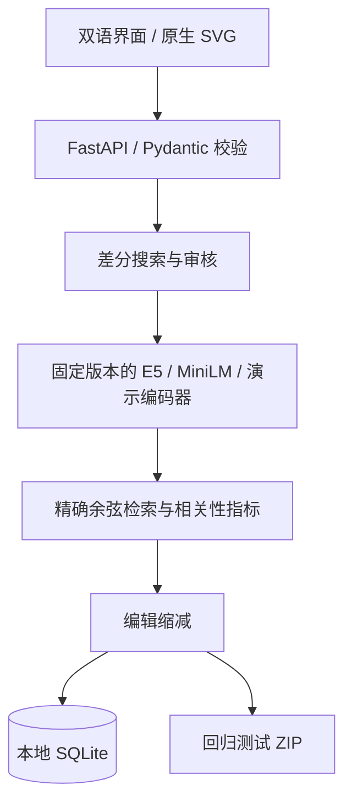

# Embedding Microscope

[English](README.md) · [简体中文](README.zh-CN.md) · **繁體中文**

[**直接打開在線完整版 →**](https://kitho-lee.github.io/embedding-microscope/)

### 當 AI 找錯資料時，找出觸發錯誤的問題，並把它保存成測試。

**Embedding Microscope 是給 AI 問答和 RAG 開發者使用的檢索調試工具。**

你提供一組資料、幾個問題，以及“每個問題應該找到哪些資料”的標籤。工具用兩個 embedding 模型在同一份資料裏檢索，讓你看到哪些問題一個模型找對、另一個找錯，以及換一種問法後是否出現了新的錯誤。

確認錯誤案例後，它會撤銷不必要的文字改動，保留仍能觸發錯誤的最小編輯組合，並導出迴歸測試。以後換模型或調整檢索配置時，可以重跑這份測試，檢查這個已知錯誤是否再次出現。

### 你給什麼，它做什麼，最後得到什麼？

| 你提供 | 工具執行 | 你得到 |
| --- | --- | --- |
| 資料、問題、正確資料的 ID | 在相同語料上比較兩個模型的檢索排名 | 哪些問題模型 A 找對了、模型 B 沒找對 |
| 一些候選改寫 | 搜索給定的文字編輯組合 | 一個能具體展示錯誤的問法 |
| 對問法和標籤的審覈 | 撤銷不必要的編輯，保留同一個錯誤 | 更容易理解的失敗案例和可執行的迴歸測試 |

Embedding 模型會把文字變成數字向量，用來找相近的內容。但**相近不等於能回答問題**。我們檢查的是“有沒有找到正確資料”，不是評價整個聊天機器人，也不會替你生成答案。

適合選模型、排查 RAG 檢索錯誤和檢查模型遷移。直接打開[在線實驗室](https://kitho-lee.github.io/embedding-microscope/)即可使用，不需要安裝 Python；需要 Python 版本時再看下面的安裝說明。

## 先看一個真實執行的例子

以下問題與文檔保留驗證時的原始簡體文字，避免翻譯改變模型輸入。

| 查詢 | E5 相關文檔排名 | MiniLM 相關文檔排名 |
| --- | ---: | ---: |
| 李明向谁借钱？ | 1 | 1 |
| 谁把钱借给了李明？ | 1 | 2 |

兩個問句都在問：**誰借錢給李明？正確答案是王芳。**

| 文檔 | 誰借錢給誰 | 能否回答這個問題 |
| --- | --- | --- |
| 李明向王芳借了100元。 | 王芳 → 李明 | 能，出借人是王芳 |
| 张伟向李明借了100元。 | 李明 → 張偉 | 不能，這裏李明是出借人 |

改寫問題後，MiniLM 把第二條幹擾文檔排在了正確文檔前面；E5 仍把正確文檔排在第一位。**張偉是錯誤檢索結果中的人物，不是正確答案。**我們觀察到的是檢索排名錯誤，不能僅憑這個例子確定模型內部的出錯原因。

這只是固定模型版本下的小語料觀察，不代表模型總體優劣；這裏的分數差很小，排名也可能對環境或輸入變化敏感。

## 安裝與啓動

需要 Python 3.10+。

```bash
git clone https://github.com/Kitho-Lee/embedding-microscope.git
cd embedding-microscope
python -m venv .venv
source .venv/bin/activate
pip install -e '.[models,test]'
uvicorn app.main:app --host 127.0.0.1 --port 8000
```

Windows PowerShell 激活環境：`.venv\Scripts\Activate.ps1`。

打開 http://127.0.0.1:8000。真實模型首次運行需要從 Hugging Face 下載權重，之後使用本地緩存。若暫時只體驗界面，可以安裝 `pip install -e '.[test]'`，使用“載入演示數據（無需下載）”。演示編碼器是確定性的哈希詞袋，不能用於判斷真實模型質量。

## 第一次使用：六個步驟

1. **載入數據。**點擊演示數據，或者載入真實模型示例；也可以從文件導入自己的 JSON。
2. **校驗與搜索。**選擇模型 A / B，設置 Top-k 和每查詢變體預算，點擊“校驗導入”，通過後運行差分搜索。Ctrl / ⌘ + Enter 也能運行搜索。
3. **讀結果。**概覽矩陣展示原始查詢；候選排名圖展示改寫前後。綠色表示 Top-k 至少包含一個相關文檔，紅色表示沒有。圖中越靠上排名越好。
4. **審覈。**展開兩個模型的排名表，覈對文檔標籤與變體含義。填寫審覈依據，再選擇接受、拒絕或不確定。可以搜索候選、按編輯數量排序或篩選審覈狀態。
5. **縮減。**接受模型分歧案例後點擊縮減編輯，查看哪些編輯可以撤銷。新文本仍需審覈，不能因爲算法保留了失敗就自動認爲語義等價。
6. **導出。**接受最終候選後導出 ZIP，解壓並在已安裝項目的環境中運行 `pytest test_regression.py`。已知失敗在修復前應當報錯，這是測試捕獲問題的表現。

頁面頂部“使用指南”也包含這些步驟。語言切換會記住選擇，並保留輸入草稿和審覈備註；不會翻譯或改寫用戶語料。

## 數據格式

參考 [`examples/dataset.json`](examples/dataset.json)。相關性爲二元標籤，`relevant` 是相關文檔 ID 列表。

```json
{
  "documents": [
    {"id": "d1", "text": "相关文档"},
    {"id": "d2", "text": "干扰文档"}
  ],
  "queries": [{
    "id": "q1", "text": "寻找笔记软件", "relevant": ["d1"],
    "rules": [{"source": "寻找", "replacement": "找"}]
  }],
  "models": ["demo-word", "demo-char"],
  "k": 1,
  "budget_per_query": 63
}
```

文檔和查詢 ID 必須唯一，相關標籤必須存在。每個替換片段須在原句中恰好出現一次，規則之間不能重疊。規則留空可只比較原始查詢。導入會填充模型與參數，之後可以通過界面修改。

目前限制爲 200 文檔、20 查詢、每查詢 6 條規則、63 個變體；界面文件限制爲 5 MiB。項目使用精確檢索，適合小型診斷實驗，不是大規模向量服務。

## 技術流程



| 實現 | 技術意義 |
| --- | --- |
| 固定模型 revision、E5 query/passage 前綴、歸一化向量 | 避免編碼約定錯誤，並記錄權重版本 |
| 批量編碼與精確矩陣檢索、按 ID 確定性處理同分 | 將模型行爲與近似索引損失區分開 |
| 每次運行復用文檔向量、按編輯數量遍歷、查詢內文本去重 | 搜索預算和覆蓋範圍明確可查 |
| 優先級使用失敗對比和相關文檔排名差 | 不把不同模型的原始餘弦分數當成統一尺度 |
| 縮減保留同一個成功模型與失敗模型 | 在選定編輯子集內得到精確的最少規則數 |
| 審覈門檻、SQLite 持久化、完整縮減軌跡 | 未審覈案例不會被導出爲迴歸真值 |
| 輸入與參數 SHA-256、依賴版本、模型版本、截斷提示 | 可以檢查實際運行條件 |



對於總計 T 個查詢與變體、N 個文檔、D 維向量，兩個模型的打分成本約爲 `O(2 × T × N × D)`，另加模型編碼成本。文檔矩陣每模型每運行只計算一次。最多六條規則可產生 63 個非空子集；這是受控有限搜索，不是新的對抗攻擊算法。

## 檢查與復現

```bash
pytest
python scripts/verify_real_models.py
python scripts/verify_lab.py
```

實現測試覆蓋非法導入、錯誤標籤、重疊規則、預算、審覈與導出門檻、持久化、縮減、輸入指紋和雙語頁面。兩種真實模型已下載並在 CPU 上運行；六組小實驗檢查 384 維向量、歸一化、有限分數、指標獨立復算和復跑一致性。真實雙編輯案例也驗證了 2→1 縮減及迴歸導出。

機器可讀記錄見 [`verification/`](verification/)。[`requirements-verified.txt`](requirements-verified.txt) 是已驗證環境的版本快照，不是跨平臺鎖文件。

本地狀態保存在 `work/lab.sqlite`，不會提交到 Git。可通過 `EM_LAB_DB` 修改路徑；完整運行 JSON 用於保存配置、排名與審覈記錄。語言字符串在 `app/static/ui-en.json`；修改中文界面後先安裝 `pip install -e '.[i18n]'`，再運行 `python scripts/build_i18n.py` 更新英文版本。

## 常見問題

- **首次運行很慢？**真實模型需要下載權重；檢查網絡和服務端日誌。體驗界面可先選演示編碼器。
- **沒有候選？**當前規則空間裏沒有篩選到分歧或新增失敗；這不能證明模型對其他擾動魯棒。
- **縮減或導出按鈕不可用？**先填寫依據並接受候選。縮減僅支持一個模型成功、另一個模型失敗的案例。
- **導出的測試失敗？**這是已知檢索問題的預期結果。修復檢索行爲後，它才應通過。
- **爲什麼英文界面還有中文句子？**查詢、文檔和備註屬於實驗數據，保留原文才能保證實驗內容不變。

## 邊界與相關工作

失敗定義是 Top-k 沒有已標註相關文檔，不是通用語言理解評分。“最小”只指所選案例編輯子集內的最少規則數，不是全局或字符級最小。語義與標籤依賴審覈；接受記錄判斷，不構成數學證明。長文本可能被截斷，需要先排查截斷因素。

測試語料由人工編寫，不能當作代表性生產基準。尚未實現獨立測試集上的檢索修復比較或模型微調。項目是單用戶本地工具，沒有多用戶審覈隔離。

參考 [CheckList](https://github.com/marcotcr/checklist)、[TextAttack](https://github.com/QData/TextAttack)、[WizMap](https://github.com/poloclub/wizmap)、[Aquin CLI](https://www.aquin.app/docs/inspection/embedding) 與 [ALEE](https://github.com/Andrian0s/any-lang-embed-eval)。特色是將語料、差分、審覈、縮減和迴歸連接成可檢查的工作流，不宣稱首創。

MIT License。模型權重遵循各自許可證。

## 直接在線使用，無需本地安裝

公開網址支持導入任意符合格式的語料，實時運行兩個真實模型。不是預計算演示，也不需要 Python、賬號或 API Key。模型通過 Transformers.js 3.8.1 在瀏覽器中執行：固定 Xenova ONNX 轉換版本，q8 量化與 WASM，使用 E5 前綴、均值池化和歸一化向量。

首次會從 Hugging Face 下載較大的模型文件，並從 jsDelivr 加載運行庫，之後使用瀏覽器緩存。速度和容量取決於設備 CPU 與內存。語料不會發送到模型推理服務器。在線版提供簡體中文、繁體中文和 English；搜索、審覈、縮減、記錄保存都在瀏覽器完成。

真實模型的在線案例導出 Node.js 迴歸測試；演示編碼器導出 JSON。解壓後安裝 Node.js 18+，運行 `npm install @huggingface/transformers@3.8.1`，再執行 `node test_regression.mjs`。Python 版仍提供 pytest。瀏覽器 WASM 與 Node CPU 的近似同分排名可能不同，需檢查分數；量化結果也不能直接冒充 Python fp32 驗證結果。

在線源碼在 `docs/site/`，GitHub Pages 發佈 `/docs`。更新界面後執行 `python scripts/build_i18n.py` 和 `python scripts/build_site.py`。瀏覽器算法測試可運行 `node --test tests/test_browser.mjs`。
